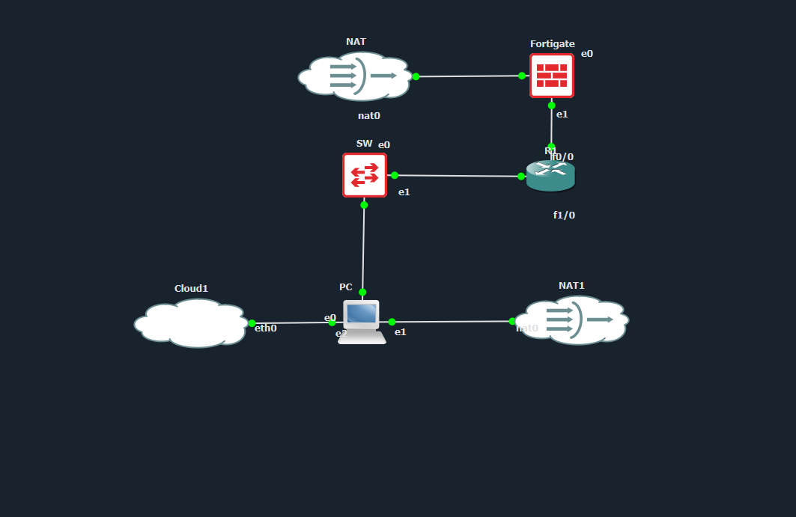
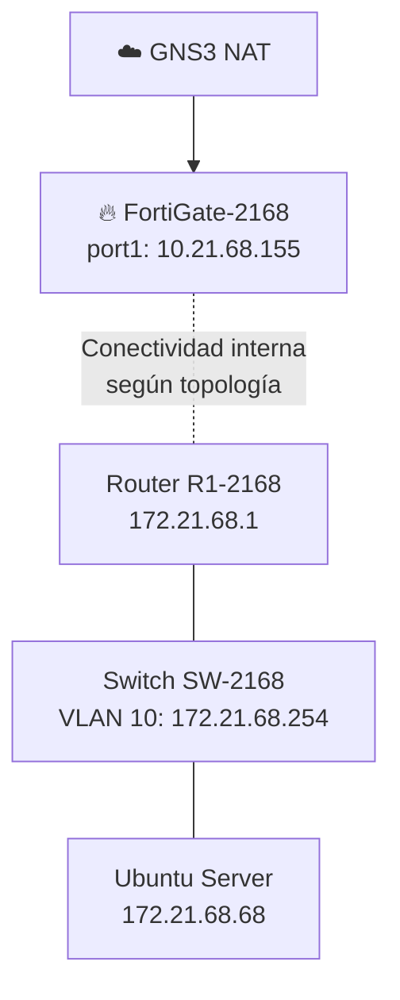
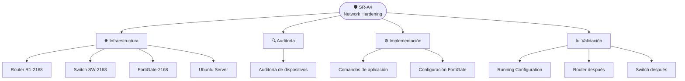
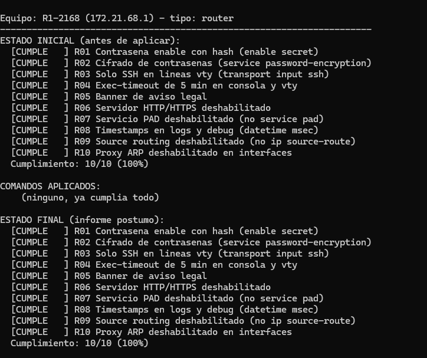
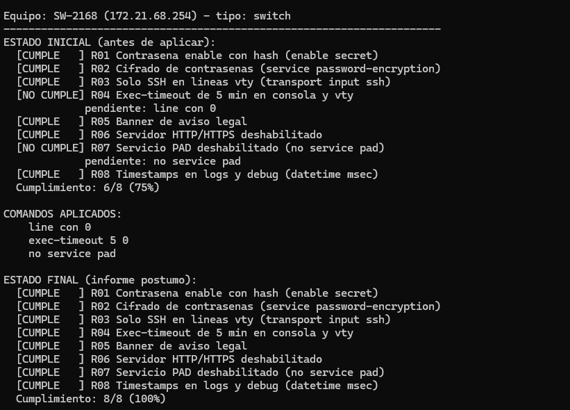

# 🛡️ SR-A4 | Auditoría y Hardening de Infraestructura de Red

<p align="center">
  
</p>

<p align="center">
  <b>Auditoría de seguridad, análisis de configuraciones y endurecimiento de dispositivos de red.</b>
  <br>
  Implementación y validación de medidas de seguridad en un entorno virtualizado mediante GNS3.
</p>

<p align="center">
  
  
  
  
</p>

---

## 📑 Tabla de contenidos

- [Descripción del proyecto](#-descripción-del-proyecto)
- [Objetivos](#-objetivos)
- [Arquitectura de red](#-arquitectura-de-red)
- [Plan de direccionamiento IP](#-plan-de-direccionamiento-ip)
- [Mapa interactivo](#-mapa-interactivo-de-la-infraestructura)
- [Tecnologías y herramientas](#-tecnologías-y-herramientas)
- [Auditoría de seguridad](#-auditoría-de-seguridad)
- [Implementación del Hardening](#-implementación-del-hardening)
- [Evidencias de implementación](#-evidencias-de-implementación)
- [Configuraciones e informes](#-configuraciones-e-informes)
- [Demostración en video](#-demostración-en-video)
- [Estructura del repositorio](#-estructura-del-repositorio)
- [Conclusiones](#-conclusiones)

---

## 📌 Descripción del proyecto

Este repositorio contiene el desarrollo de la asignación SR-A4, enfocada en la auditoría de seguridad y el endurecimiento (Hardening) de dispositivos de infraestructura de red.

El proyecto consiste en evaluar las configuraciones de los dispositivos, identificar posibles incumplimientos de seguridad y aplicar medidas correctivas para fortalecer la infraestructura tecnológica.

La implementación se desarrolla en un entorno virtualizado mediante GNS3, integrando dispositivos de red como routers, switches y un firewall FortiGate, además de un servidor Ubuntu.

Se documentan los procedimientos de auditoría, comandos utilizados, configuraciones aplicadas y evidencias obtenidas antes y después de las modificaciones.

El repositorio funciona como documentación técnica del proceso de evaluación, implementación y validación de las medidas de seguridad.

## 🎯 Objetivos

### Objetivo general

Implementar medidas de seguridad mediante auditorías y técnicas de Hardening para fortalecer la configuración de los dispositivos que conforman una infraestructura de red.

### Objetivos específicos

- Analizar las configuraciones de los dispositivos de red.
- Identificar posibles vulnerabilidades y configuraciones inseguras.
- Realizar auditorías sobre routers, switches y firewall.
- Aplicar medidas correctivas mediante comandos de configuración.
- Fortalecer los controles de acceso y administración.
- Verificar las configuraciones después de aplicar las medidas.
- Documentar los resultados mediante evidencias y archivos de configuración.

---

## 🌐 Arquitectura de red

La infraestructura se encuentra implementada en GNS3 y está compuesta por diferentes dispositivos que permiten desarrollar las pruebas de auditoría y endurecimiento.

### Topología general

<p align="center">
  
</p>

### Dispositivos involucrados

| Dispositivo | Identificación | Función |
|---|---|---|
| Router | R1-2168 | Enrutamiento de la infraestructura |
| Switch | SW-2168 | Conectividad y administración mediante VLAN 10 |
| Firewall | FortiGate-2168 | Seguridad perimetral y conexión WAN |
| Servidor | Ubuntu | Servidor dentro de la infraestructura |
| NAT Cloud | GNS3 NAT | Conectividad hacia la red externa |

---

## 📡 Plan de direccionamiento IP

El direccionamiento IP permite identificar los dispositivos que forman parte de la infraestructura y establecer la comunicación entre los diferentes segmentos de red.

### Tabla de direccionamiento

| Dispositivo | Interfaz | Dirección IP | Función |
|---|---|---|---|
| R1-2168 | Interfaz hacia SW | `172.21.68.1` | Enrutamiento |
| SW-2168 | VLAN 10 | `172.21.68.254` | Administración del switch |
| FortiGate-2168 | port1 (WAN) | `10.21.68.155` | Conexión hacia NAT |
| Ubuntu Server | Interfaz de red | `172.21.68.68` | Servidor interno |

### Distribución de segmentos

| Segmento | Dirección utilizada | Dispositivos |
|---|---|---|
| Red interna | `172.21.68.0` | Router, Switch y Ubuntu |
| Red WAN / NAT | `10.21.68.155` | Interfaz WAN del FortiGate |

### Representación gráfica del direccionamiento



**Consideraciones del direccionamiento:**

- El router R1-2168 utiliza `172.21.68.1` en su interfaz hacia el switch.
- El switch SW-2168 utiliza la VLAN 10 con dirección de administración `172.21.68.254`.
- El FortiGate-2168 utiliza `10.21.68.155` en su interfaz WAN `port1`, conectada a la nube NAT.
- Ubuntu Server utiliza `172.21.68.68` dentro de la infraestructura interna.

> Las máscaras de subred, gateways y direcciones de las interfaces adicionales deben consultarse en las configuraciones originales. No se asignan valores que no estén documentados.

---

## 🗺️ Mapa interactivo de la infraestructura

El siguiente diagrama permite explorar los principales componentes del proyecto, sus funciones y las evidencias relacionadas.



---

## 🧰 Tecnologías y herramientas

| Tecnología | Utilización |
|---|---|
| GNS3 | Simulación y virtualización de infraestructura |
| Cisco Router | Enrutamiento y configuración de red |
| Cisco Switch | Conmutación y administración de VLAN |
| FortiGate | Firewall y seguridad perimetral |
| Ubuntu Server | Servidor dentro de la infraestructura |
| CLI | Auditoría y aplicación de configuraciones |
| Git | Control de versiones |
| GitHub | Almacenamiento y documentación del proyecto |
| Mermaid | Diagramas y representación de la infraestructura |

---

## 🔍 Auditoría de seguridad

La auditoría constituye una de las etapas fundamentales del proyecto.

Durante esta fase se revisan las configuraciones existentes de los dispositivos para identificar posibles incumplimientos y parámetros que requieren corrección.

Se recopilan evidencias que permiten documentar el estado inicial de los equipos.

### Evidencia de auditoría

<p align="center">
  
</p>

Esta evidencia forma parte del proceso de identificación y revisión de las configuraciones de seguridad.

---

## ⚙️ Implementación del Hardening

Una vez identificados los parámetros que requieren atención, se procede a implementar las medidas correctivas correspondientes.

El proceso incluye la revisión de configuraciones, ejecución de comandos y comprobación de los cambios realizados.

### Comandos aplicados

<p align="center">
  
</p>

### Configuración de acceso en FortiGate

<p align="center">
  
</p>

### Revisión de la configuración en ejecución

<p align="center">
  
</p>

---

## 📸 Evidencias de implementación

En esta sección se presentan las capturas relacionadas con los dispositivos y procedimientos realizados durante el desarrollo de la asignación.

### 1. Router R1-2168

<p align="center">
  
</p>

Evidencia del router utilizado en la infraestructura y de su participación en el entorno de red.

### 2. Switch SW-2168

<p align="center">
  
</p>

Evidencia del switch utilizado para la conectividad y administración de la infraestructura mediante VLAN 10.

### 3. Firewall FortiGate-2168

<p align="center">
  
</p>

Evidencia del firewall utilizado para la implementación de controles de seguridad perimetral.

### 4. Aplicación de configuraciones

<p align="center">
  
</p>

Evidencia del proceso de aplicación de las medidas correctivas.

---

## 📂 Configuraciones e informes

El repositorio cuenta con directorios destinados a almacenar las configuraciones de los dispositivos, scripts y resultados obtenidos durante las pruebas.

### Informes

| Archivo | Descripción |
|---|---|
| `audit.txt` | Registro del proceso de auditoría |
| `apply.txt` | Registro de aplicación de configuraciones |
| `router despues.txt` | Información del router después de la implementación |
| `sw despues.txt` | Información del switch después de la implementación |

### Configuraciones

El directorio `configs/` contiene los archivos de configuración utilizados durante el desarrollo de la práctica.

### Scripts

El directorio `scripts/` está destinado a los comandos y procedimientos automatizados utilizados durante la implementación.

---

## 🎥 Demostración en video

Se incluye una demostración audiovisual del proyecto donde se presenta el entorno de trabajo y el desarrollo de la infraestructura implementada.

<p align="center">
  <a href="https://www.youtube.com/watch?v=YMaObqGHV1g">
    
  </a>
</p>

<p align="center">
  <a href="https://youtu.be/YMaObqGHV1g">
    
  </a>
</p>

---

## 📁 Estructura del repositorio

```text
SR--A4/
│
├── a4img/
│   ├── RO.png
│   ├── SW.png
│   ├── Topologia.png
│   ├── audit a dispositivos incumplimiento.png
│   ├── coamndo para aplicar.png
│   ├── comos e ve aplicado.png
│   ├── fortigate.png
│   ├── ls running config.png
│   └── set allowaccess ping.png
│
├── configs/
│   └── Configuraciones de dispositivos
│
├── informes/
│   ├── apply.txt
│   ├── audit.txt
│   ├── router despues.txt
│   └── sw despues.txt
│
├── scripts/
│   └── Scripts y comandos
│
└── README.md
```

---

## 📝 Conclusiones

El desarrollo de esta asignación permitió trabajar con diferentes componentes de una infraestructura de red, aplicando conceptos de auditoría y endurecimiento de dispositivos.

Mediante la revisión de configuraciones, identificación de incumplimientos y aplicación de medidas correctivas, se trabajó en el fortalecimiento de la seguridad de los equipos involucrados.

La utilización de GNS3 permitió disponer de un entorno virtualizado para realizar las pruebas y documentar los procedimientos sin depender de una infraestructura física.

Finalmente, la recopilación de configuraciones, informes y evidencias facilita la trazabilidad de los cambios realizados y permite consultar los resultados del proceso de Hardening.

---

<p align="center">
  <b>🛡️ SR-A4 | NETWORK SECURITY & HARDENING</b>
  <br>
  Desarrollado por <b>sebas533</b>
  <br><br>
  <a href="https://github.com/sebas533/SR--A4">📂 Repositorio GitHub</a>
  &nbsp; | &nbsp;
  <a href="https://youtu.be/YMaObqGHV1g">🎥 Video demostrativo</a>
</p>
