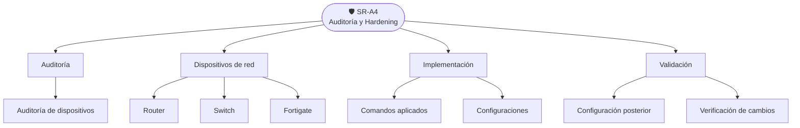
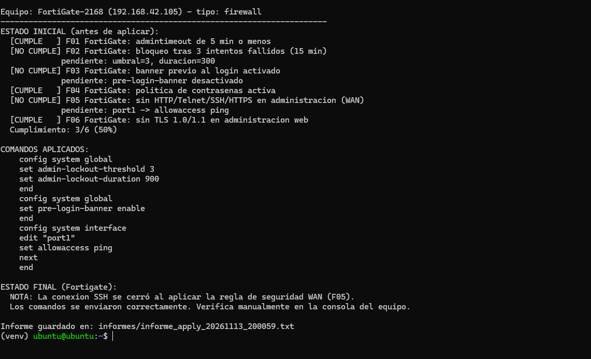

# 🛡️ SR-A4 | Auditoría y Hardening de Infraestructura de Red


## 📑 Índice

- [Descripción del proyecto](#-descripción-del-proyecto)
- [Objetivos](#-objetivos)
- [Arquitectura de red](#-arquitectura-de-red)
- [Mapa interactivo de evidencias](#-mapa-interactivo-de-evidencias)
- [Tecnologías y herramientas](#-tecnologías-y-herramientas)
- [Auditoría de seguridad](#-auditoría-de-seguridad)
- [Implementación del Hardening](#-implementación-del-hardening)
- [Evidencias del proyecto](#-evidencias-del-proyecto)
- [Estructura del repositorio](#-estructura-del-repositorio)
- [Resultados y validaciones](#-resultados-y-validaciones)
- [Conclusión](#-conclusión)

---

## 📌 Descripción del proyecto

Este repositorio documenta el desarrollo de la asignación SR-A4, enfocada en la auditoría de seguridad y el endurecimiento (Hardening) de dispositivos de infraestructura de red.

El proyecto contempla la revisión de configuraciones existentes, identificación de posibles incumplimientos de seguridad y aplicación de medidas correctivas orientadas a mejorar la protección de los dispositivos.

Se documentan las configuraciones de routers, switches y dispositivos Fortigate, incluyendo evidencias del estado inicial, comandos utilizados y resultados posteriores a la implementación.

El objetivo es demostrar el proceso de evaluación, corrección y validación de configuraciones de seguridad en una infraestructura de red.

## 🎯 Objetivos

### Objetivo general

Evaluar y fortalecer la seguridad de una infraestructura de red mediante auditorías de configuración y aplicación de medidas de Hardening en los dispositivos involucrados.

### Objetivos específicos

- Identificar configuraciones que no cumplen con las medidas de seguridad establecidas.
- Auditar los dispositivos de infraestructura.
- Revisar las configuraciones actuales de routers y switches.
- Aplicar comandos y medidas correctivas.
- Verificar los cambios realizados.
- Documentar las evidencias antes y después de la implementación.
- Mantener un registro de las configuraciones y procedimientos utilizados.

## 🌐 Arquitectura de red

La infraestructura implementada se encuentra documentada mediante el siguiente esquema:

<p align="center">
  
</p>

**Descripción:** La topología representa la infraestructura utilizada durante las pruebas de auditoría y endurecimiento. En ella se identifican los dispositivos que forman parte del entorno de trabajo.

## 🗺️ Mapa interactivo de evidencias

El siguiente mapa permite navegar entre las principales áreas documentadas del proyecto. Selecciona cada elemento para consultar sus evidencias.



> Nota: El mapa funciona como índice visual de evidencias dentro de GitHub. Los enlaces permiten acceder a los archivos correspondientes.

## 🧰 Tecnologías y herramientas

| Herramienta | Utilización |
|---|---|
| Routers | Configuración y auditoría de dispositivos |
| Switches | Revisión y endurecimiento |
| Fortigate | Administración y configuración de seguridad |
| CLI | Ejecución de comandos |
| Git y GitHub | Control de versiones y documentación |
| Mermaid | Diagramas y navegación visual |

## 🔍 Auditoría de seguridad

La auditoría constituye una de las etapas principales del proyecto.

Durante esta fase se revisan las configuraciones de los dispositivos para identificar parámetros que requieren atención y posibles incumplimientos de seguridad.

Se mantiene evidencia de los resultados obtenidos durante la evaluación.

### Evidencia de auditoría

<p align="center">
  
</p>

## 🔧 Implementación del Hardening

Después de realizar la auditoría, se procede con la aplicación de las medidas correctivas correspondientes.

Se utilizan comandos de configuración para modificar los parámetros identificados durante la evaluación.

### Comandos utilizados

<p align="center">
  
</p>

### Configuración y verificación

Se utilizan comandos de consulta para comprobar el estado de las configuraciones y validar los cambios realizados.

<p align="center">
  
</p>

### Configuración de acceso y administración

<p align="center">
  
</p>

## 📸 Evidencias del proyecto

### 1. Router

<p align="center">
  
</p>

Evidencia correspondiente al dispositivo router utilizado en la infraestructura.

### 2. Switch

<p align="center">
  
</p>

Evidencia del dispositivo switch y su participación en la infraestructura.

### 3. Fortigate

<p align="center">
  
</p>

Evidencia del dispositivo Fortigate utilizado durante el desarrollo de la práctica.

### 4. Aplicación de las configuraciones

<p align="center">
  
</p>

Evidencia visual del proceso de implementación de las medidas de seguridad.

## 📁 Estructura del repositorio

```text
SR--A4/
│
├── a4img/
│   ├── RO.png
│   ├── SW.png
│   ├── Topologia.png
│   ├── audit a dispositivos incumplimiento.png
│   ├── coamndo para aplicar.png
│   ├── comos e ve aplicado.png
│   ├── fortigate.png
│   ├── ls running config.png
│   └── set allowaccess ping.png
│
├── configs/
│   └── Configuraciones de los dispositivos
│
├── informes/
│   ├── apply.txt
│   ├── audit.txt
│   ├── router despues.txt
│   └── sw despues.txt
│
├── scripts/
│   └── Scripts y herramientas utilizados
│
└── README.md
```

## 📊 Resultados y validaciones

La documentación del proyecto permite comparar la información obtenida durante la auditoría con las configuraciones posteriores a la implementación.

Los archivos de informes contienen información de referencia para revisar los procedimientos y resultados.

| Archivo | Descripción |
|---|---|
| `audit.txt` | Registro de auditoría |
| `apply.txt` | Registro de aplicación de medidas |
| `router despues.txt` | Configuración posterior del router |
| `sw despues.txt` | Configuración posterior del switch |

La validación final debe realizarse mediante la revisión de las configuraciones y las evidencias recopiladas.

## 📝 Conclusión

El desarrollo de esta práctica permite comprender la importancia de realizar auditorías periódicas y aplicar medidas de Hardening en los dispositivos que conforman una infraestructura de red.

La revisión de configuraciones, identificación de incumplimientos, aplicación de comandos y validación de resultados constituyen procesos fundamentales para mejorar la seguridad de los entornos tecnológicos.

Además, la documentación de cada procedimiento facilita la trazabilidad de los cambios y permite disponer de evidencias para futuras revisiones de seguridad.

---

<p align="center">
  <b>SR-A4 | Network Security & Hardening</b>
  <br>
  Desarrollado por <b>sebas533</b>
  <br>
  <a href="https://github.com/sebas533/SR--A4">Ver repositorio en GitHub</a>
</p>
